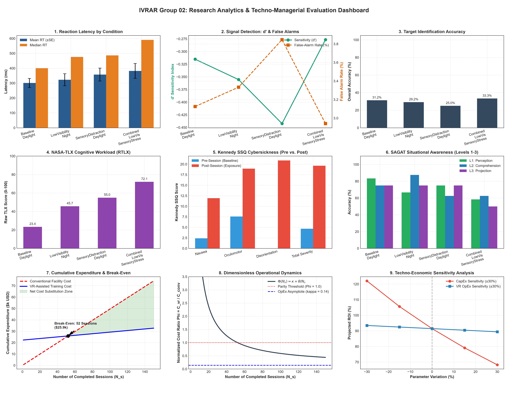

# IVRAR GROUP 02
## Immersive VR Sensory-Stress Defensive Security Training under Low Visibility

[](https://opensource.org/licenses/MIT)
[](https://unity.com/)
[](https://unity.com/srp/universal-render-pipeline)
[](https://www.khronos.org/openxr/)
[](telemetry/test_evaluation_tools.py)
[](https://engineering.nmims.edu/)

---

## 🎯 Executive Summary & Research Domain

**Authorized Research Question:**  
> *"How can an immersive VR sensory-stress simulation improve target prioritization and reaction latency for defensive security trainees under simulated low-visibility nighttime conditions?"*

This repository hosts the complete academic engineering testbed, research telemetry infrastructure, human factors assessment engines, and techno-economic evaluation models developed by **IVRAR Group 02** (Department of Computer Engineering, SVKM's NMIMS MPSTME, AY2026–27). 

The platform investigates the cognitive, perceptual, and psychomotor performance of defensive personnel under mesopic visual degradation (nighttime illumination, volumetric fog) and sudden acute sensory stressors (spatialized 3D audio startle cues, peripheral 6 Hz strobe bursts). Decision dynamics are evaluated using Signal Detection Theory ($d'$, $\beta$, $c$), millisecond reaction latency, multi-dimensional cognitive workload (NASA-TLX), cybersickness adaptation (Kennedy SSQ pre/post), and situational awareness (SAGAT freeze probes).

---

## 👥 Academic Team Roster & Technical Responsibilities

| Roll No | Candidate Name | Academic Role | Technical Subsystem Responsibilities |
| :---: | :--- | :--- | :--- |
| **N024** | **Ranish Devadiga** | Lead XR Systems Architect | Unity OpenXR integration, mesopic illumination shaders, volumetric distance fog, flashlight inverse-square attenuation, peripheral strobe cues, and 6-DoF defensive weapon rig. |
| **N042** | **Hriday Jain** | Human Factors & Usability Engineer | Multi-dimensional NASA-TLX cognitive workload assessment, Kennedy SSQ pre/post cybersickness evaluation ($\Delta \text{SSQ}$), SAGAT simulation freeze probes with display occlusion, and ethical protocols. |
| **N047** | **Vedika Kaki** | Spatial Telemetry & Data Lead | 90 Hz monotonic telemetry logging, millisecond reaction latency tracking, Signal Detection Theory ($d'$, $\beta$, $c$) with log-linear corrections, and inferential statistical pipelines. |
| **N062** | **Medha Mishra** | Techno-Managerial Product Manager | Dimensionless techno-economic model ($\kappa, \theta, \eta^*, \Phi, \Psi$), live-fire facility rental substitution, consumable ammunition amortization, break-even analysis, and research analytics dashboard. |

---

## 🏛️ System Architecture

The project is structured into modular layers separating core simulation lifecycle, environmental illumination, sensory distraction, target presentation, telemetry, human factors, and UI:

```
ShootingRangeVR/
├── Assets/
│   ├── Scenes/
│   │   ├── Group02_MainScene.unity            # [Active Scene 0] Primary Group 02 research testbed & UI
│   │   └── ShootingRange/
│   │       ├── ShootingRange.unity            # [Scene 1] Original baseline scene (100% functional)
│   │       └── ShootingRange_OriginalBackup.unity # [Scene 2] Preserved backup of original scene
│   ├── Scripts/
│   │   ├── Core/                              # SimulationManager, ExperimentConfig, XRInitializationDiagnostic
│   │   ├── Environment/                       # LowVisibilityEnvironmentManager, FlashlightController
│   │   ├── SensoryStress/                     # SensoryStressTargetManager, StrobeStressController, AcousticStressController
│   │   ├── TargetManagement/                  # TacticalTarget, TargetTrialMetadata, Poisson target spawning
│   │   ├── Telemetry/                         # ReactionLatencyTelemetryLogger, SignalDetectionMetrics, HeadKinematicsLogger
│   │   ├── HumanFactors/                      # NasaTlxAssessment, KennedySsqAssessment, SagatAssessment, PostTrialAssessmentController
│   │   └── UI/                                # MainMenuController, ParticipantSetupUI, ResearchConfigUI, HUDController
│   ├── ScriptableObjects/                     # Config_Baseline, Config_LowVisibility_SensoryStress, Config_DefaultResearch
│   └── Tests/
│       ├── Editor/                            # HumanFactorsTests, SignalDetectionMetricsTests, LowVisibilityEnvironmentTests
│       └── Runtime/                           # TelemetryLoggerTests, SimulationLifecycleTests
├── telemetry/                                 # Statistical toolchain, CSV logs, publication dashboard generator
│   ├── analyze_signal_detection.py            # SDT sensitivity (d'), response bias, latency paired t-tests
│   ├── analyze_human_factors.py               # NASA-TLX, Kennedy SSQ (pre/post), SAGAT rubric evaluation
│   ├── sensory_stress_defense_roi.py          # Dimensionless techno-economic model & 9-panel dashboard
│   ├── generate_synthetic_test_data.py        # Deterministic test fixture generator
│   ├── test_signal_detection.py               # 8 unit tests for SDT formulas and latency stats
│   ├── test_human_factors.py                  # 7 unit tests for psychometric instruments and zero-PII security
│   ├── test_evaluation_tools.py               # 9 unit tests for techno-economic models and CSV ingestion
│   └── figures/                               # Publication-ready charts and analytics dashboard
└── docs/                                      # Comprehensive research dossiers and methodological protocols
    ├── ARCHITECTURE.md                        # Architectural decomposition and design patterns
    ├── FINAL_REQUIREMENTS_VERIFICATION.md     # Requirements verification matrix (PASS / MANUAL VERIFICATION)
    ├── HUMAN_FACTORS_PROTOCOL.md              # NASA-TLX, Kennedy SSQ, SAGAT protocols and ethics
    ├── TECHNO_ECONOMIC_MODEL.md               # Dimensionless operational formulas and break-even derivation
    ├── LOW_VISIBILITY_CALIBRATION.md          # Photometric illumination calibration procedures
    ├── SENSORY_SAFETY_PROTOCOL.md             # Photic seizure limits and acoustic decibel caps
    └── ORIGINAL_ATTRIBUTION.md                # Attribution to Anton Pokidov and baseline mechanics
```

---

## 🔬 Experimental Conditions & Methodology

The simulation supports four randomized, counterbalanced experimental blocks:

1. **Condition 1 (Baseline Daylight):** Unobstructed clear ambient visibility, no acute sensory distractions. Establishes baseline reaction latency and signal detection capability.
2. **Condition 2 (Low-Visibility Nighttime):** Simulated mesopic ambient illumination ($0.5 - 5.0\text{ lux}$) and exponential-squared distance fog ($\alpha = 0.045\text{ m}^{-1}$). Trainee operates with tactical weapon-mounted illumination.
3. **Condition 3 (Sensory Distraction):** Daylight visibility with acute sensory startle cues: spatialized 3D acoustic gunfire/siren spikes ($<85\text{ dB SPL}$) and peripheral visual strobe flashes ($\le 6\text{ Hz}$).
4. **Condition 4 (Combined Condition):** Simultaneous mesopic low visibility, distance fog, and multi-modal sensory distractions. Evaluates peak cognitive workload and situational awareness degradation.

### Signal Detection Theory (SDT) Framework
Each target presentation constitutes a signal detection trial:
- **Hostile Target (Signal Present):** Threat weapon brandished $\implies$ **Trigger Pull = HIT**, **Withhold Fire = MISS**.
- **Civilian Target (Signal Absent):** Unarmed neutral bystander $\implies$ **Trigger Pull = FALSE ALARM**, **Withhold Fire = CORRECT REJECTION**.

Metrics computed with Hautus (1995) log-linear extreme-rate correction:
$$d' = Z(\text{Hit Rate}) - Z(\text{FA Rate})$$
$$c = -0.5 \cdot [Z(\text{Hit Rate}) + Z(\text{FA Rate})]$$
$$\beta = \exp(-d' \cdot c)$$

---

## 📋 Human Factors Instruments

1. **NASA Task Load Index (NASA-TLX):** Evaluates Mental Demand, Physical Demand, Temporal Demand, Performance, Effort, and Frustration (0–100 scale). Unweighted **Raw TLX (RTLX)** is computed:
   $$\text{RTLX} = \frac{1}{K} \sum_{i=1}^K D_i$$
2. **Kennedy Simulator Sickness Questionnaire (SSQ):** 16 symptoms evaluated before immersion ($t_{\text{pre}}$) and after immersion ($t_{\text{post}}$). Published weights applied:
   - $\text{Nausea} = \text{Raw}_N \times 9.54$
   - $\text{Oculomotor} = \text{Raw}_O \times 7.58$
   - $\text{Disorientation} = \text{Raw}_D \times 13.92$
   - $\text{Total Severity} = (\text{Raw}_N + \text{Raw}_O + \text{Raw}_D) \times 3.74$
   - $\Delta \text{SSQ} = \text{Score}_{\text{post}} - \text{Score}_{\text{pre}}$
3. **Situational Awareness Global Assessment Technique (SAGAT):** Simulation freezes (`Time.timeScale = 0`) with display occlusion to probe internal mental models across Endsley Levels:
   - **Level 1 (Perception):** Target spatial sector, distance tier, illumination state.
   - **Level 2 (Comprehension):** Target threat identity, active sensory stressor.
   - **Level 3 (Projection):** Required tactical rule of engagement.

---

## 💰 Dimensionless Techno-Economic Model

The platform includes a dimensionless operational model comparing VR-assisted training against conventional facility rental and live ammunition training:

- **Operating Cost Ratio:** $\kappa = \frac{\text{OpEx}_{\text{vr}}}{\text{OpEx}_{\text{conv}}} = 0.141$
- **Capital Intensity Ratio:** $\theta = \frac{\text{CapEx}_{\text{vr}}}{\text{OpEx}_{\text{conv}}} = 44.848$
- **Break-Even Session Count:** $N_s^* = \frac{\theta}{1 - \kappa} = 52.2\text{ sessions}$
- **Normalized Cost Ratio:** $\Phi(N_s) = \kappa + \frac{\theta}{N_s}$ (Converges to asymptote $\kappa$ as $N_s \to \infty$)
- **Baseline Outputs ($N_s = 100$, $N_p = 50$):**
  - Conventional Training Cost: **$49,500.00**
  - VR-Assisted Training Cost: **$29,200.00**
  - Cost Substitution: **$20,300.00**
  - Projected ROI: **91.4%**

> [!NOTE]
> All monetary values are parameterized modeling assumptions for academic evaluation. No empirical ammunition or facility savings are claimed without externally certified accounting records.

---

## 📊 Research Analytics Dashboard

The system generates a publication-ready 9-panel dashboard exported to `telemetry/figures/research_analytics_techno_managerial_dashboard.png`:



---

## 🛡️ Safety & Ethical Compliance

- **Zero Personally Identifiable Information (PII):** Participant IDs are strictly pseudonymous (e.g., `P01`, `P02`). Direct personal identifiers (name, email, student ID) are rejected by automated validation.
- **Photic Seizure Safety:** Visual strobe frequencies are strictly capped at $\le 6.0\text{ Hz}$ with $\le 6$ pulses per burst, strictly avoiding the 15–25 Hz photosensitive epilepsy risk band.
- **Acoustic Volume Caps:** Headset digital audio output is hard-limited to safe levels equivalent to $<85\text{ dB SPL}$.
- **Voluntary Study Withdrawal:** Participants may pause the scenario, skip questions, or withdraw at any time via an in-VR button without penalty.

---

## 🛠️ Prerequisites & Installation

### Hardware Support
- **VR Headsets:** Meta Quest 2 / 3 / Pro (via Oculus Link / AirLink), Valve Index, HTC Vive via Unity OpenXR.
- **Desktop Mode:** Full mouse and keyboard fallback mode (WASD + mouse aim + spacebar) when no HMD is connected.

### Software Requirements
- **Unity Editor:** `2020.3.25f1 LTS`
- **Render Pipeline:** Universal Render Pipeline (URP 10.7.0)
- **XR Plugin:** Unity OpenXR Plugin 1.2.8+
- **Python Environment:** Python 3.8+ (numpy, pandas, matplotlib, scipy)

### Installation Steps
1. Clone the repository:
   ```bash
   git clone https://github.com/hridayjain13/ShootingRangeVR.git
   cd ShootingRangeVR
   ```
2. Open the project in **Unity 2020.3.25f1 LTS**.
3. Install Python analytics dependencies:
   ```bash
   python -m pip install numpy pandas matplotlib scipy
   ```
4. Verify the Python test suite:
   ```bash
   python -m unittest discover -s telemetry -p "test_*.py"
   ```

---

## 🧪 Demonstration Checklist for Academic Jury

Follow this operational sequence during project demonstration:

```
========================================================================================
             IVRAR GROUP 02: IN-PERSON DEMONSTRATION CHECKLIST
========================================================================================

[ ] 1. SCENE LAUNCH & STARTUP MENU
    - Open 'Assets/Scenes/Group02_MainScene.unity' in Unity 2020.3.25f1.
    - Press Play. Verify Holographic Main Menu displays:
      * Start Simulation | Participant Setup | Research Config | Credits | Attribution
    - Verify XRInitializationDiagnostic reports OpenXR loader and refresh rate.

[ ] 2. PARTICIPANT CONFIGURATION
    - Open 'Participant Setup'. Assign pseudonymous Participant ID (e.g. 'P-101').
    - Confirm zero direct PII is requested.

[ ] 3. PRE-SESSION KENNEDY SSQ (BASELINE)
    - Administer in-VR Pre-Session SSQ (16 symptom sliders).
    - Submit baseline. Confirm record appends to telemetry.

[ ] 4. EXPERIMENTAL TRIAL SEQUENCE EXECUTION
    - Click 'Start Simulation'. Observe Poisson target presentation:
      * Left / Center / Right spatial anchors.
      * Hostile threat (brandishing weapon) vs. Unarmed civilian.
    - Engage hostile target with controller trigger (or mouse click); withhold fire on civilian.
    - Observe flashlight illumination falloff and distance fog.

[ ] 5. SENSORY STRESS INOCULATION TRIGGER
    - Observe peripheral visual strobe flash (<=6 Hz) and spatialized 3D audio startle cues.
    - Test immediate pause / stop safety override.

[ ] 6. SAGAT SIMULATION FREEZE & OCCLUSION
    - Trigger freeze probe: confirm simulation physics freeze (Time.timeScale = 0).
    - Confirm display is occluded with blanking panel.
    - Answer Level 1 (Perception), Level 2 (Comprehension), Level 3 (Projection) probes.
    - Confirm unfreeze and occlusion removal upon submission.

[ ] 7. POST-TRIAL NASA-TLX & POST-SESSION SSQ
    - Complete NASA-TLX cognitive workload assessment (Mental, Physical, Temporal, Perf, Effort, Frust).
    - Complete Post-Session Kennedy SSQ. Verify Delta SSQ computation.
    - Test voluntary withdrawal control.

[ ] 8. TELEMETRY AUDIT & PUBLICATION DASHBOARD
    - Inspect 'telemetry/human_factors_assessments.csv' and 'telemetry/reaction_latency_trial_log.csv'.
    - Execute 'python telemetry/sensory_stress_defense_roi.py'.
    - Inspect 'telemetry/figures/research_analytics_techno_managerial_dashboard.png'.
    - Verify all 9 panels populate cleanly.

========================================================================================
```

---

## 🛡️ Attribution & Baseline Compatibility

### Original Author Credit
This project is an academic research extension of **ShootingRangeVR**:
- **Original Author:** Anton Pokidov ([kaayran](https://github.com/kaayran))
- **Original Repository:** [https://github.com/kaayran/ShootingRangeVR](https://github.com/kaayran/ShootingRangeVR)
- **License:** MIT License (Copyright 2022 Anton Pokidov)

### Baseline Functionality Intact
All original weapon mechanics remain **100% functional and intact**:
- **Glock 17 Pistol:** Slide racking, magazine insertion/ejection, striker pin firing, cartridge chambering, and bullet ejection physics.
- **F-1 Fragmentation Grenade:** Pull ring, safety lever release, fuse detonation delay, and explosive fragmentation physics.
- **Tactical Gear:** Altyn helmet with audio-dampening visor and Gzhel ceramic plate armor.
- **Preserved Original Scene:** `Assets/Scenes/ShootingRange/ShootingRange.unity` and explicit backup `Assets/Scenes/ShootingRange/ShootingRange_OriginalBackup.unity`.

---

## 📄 License & Academic Integrity Notice

- **Software License:** MIT License — see the [LICENSE](LICENSE) file for details.
- **Baseline Code:** Copyright (c) 2022 Anton Pokidov.
- **IVRAR Group 02 Extensions:** Copyright (c) 2026 Ranish Devadiga, Hriday Jain, Vedika Kaki, Medha Mishra.
- **Academic Integrity Statement:** All data fixtures prefixed with `SYNTHETIC_` are synthetic demonstration test data. Empirical participant findings require institutional review board (IRB) approved user trials with $N \ge 10$ participants.
