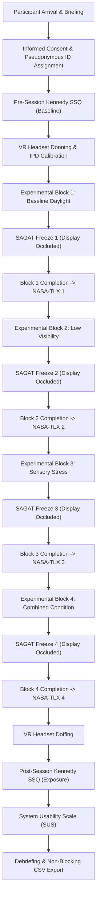

# Human Factors and Cognitive Workload Protocol

**Document Version:** 1.0.0  
**Project:** IVRAR Group 02 — Immersive VR Sensory-Stress Defensive Security Training under Low Visibility  
**Author:** Group 02 Research Team  
**Scope:** Standardized psychometric, cybersickness, and situational awareness assessment protocols conforming to recognized human factors engineering methodologies.

---

## 1. Executive Summary and Ethical Framework

This protocol establishes the standardized human-factors assessment workflows for the IVRAR Group 02 VR training simulation. The experimental framework integrates three validated instruments:

1. **NASA Task Load Index (NASA-TLX)** [Hart & Staveland, 1988]: Assesses subjective cognitive workload across six validated dimensions.
2. **Kennedy Simulator Sickness Questionnaire (SSQ)** [Kennedy et al., 1993]: Quantifies cybersickness and simulator adaptation via pre-session baseline and post-session exposure assessments.
3. **Situational Awareness Global Assessment Technique (SAGAT)** [Endsley, 1995]: Probes real-time tactical mental models across three Endsley levels during controlled simulation freezes with display occlusion.

### Ethical Safeguards and Data Governance
- **Zero Personally Identifiable Information (PII):** In accordance with institutional research ethics and GDPR/data privacy principles, no names, student IDs, email addresses, biometric identifiers, or contact details are collected or logged.
- **Pseudonymous Coding:** Every participant is assigned a pseudonymous study identifier (e.g., `P-101`, `P-102`). The master key mapping participant identities to study codes is maintained offline in a separate, encrypted repository accessible only by the Principal Investigator.
- **Voluntary Participation & Immediate Withdrawal:** Participation is entirely voluntary. Participants may pause the scenario, skip individual questions, or withdraw from the study at any time without penalty or explanation. An in-VR "Withdraw from Study" button safely halts the simulation, preserves existing consent, and logs the session status as `Withdrawn`.
- **Session Interruption Support:** Participants or researchers can pause the assessment at any point to rest, adjust headset fit, or remediate discomfort.

---

## 2. Instrument 1: NASA Task Load Index (NASA-TLX)

### 2.1 Theoretical Rationale
Developed by the NASA Ames Research Center (Hart & Staveland, 1988), the NASA-TLX is a multidimensional construct measuring subjective cognitive and physical workload. In tactical VR environments, low illumination and acute sensory stressors elevate mental processing demands and temporal urgency.

### 2.2 Workload Dimensions
All six standardized subscales are administered on a 0–100 continuous rating scale:

| Dimension | Scale Anchors | Operational Definition |
| :--- | :--- | :--- |
| **Mental Demand** | Low (0) – High (100) | How much mental and perceptual activity was required (e.g., thinking, deciding, searching, calculating)? |
| **Physical Demand**| Low (0) – High (100) | How much physical activity was required (e.g., aiming, moving, controller actuation)? |
| **Temporal Demand**| Low (0) – High (100) | How much time pressure did you feel due to the pace of stimulus presentation? |
| **Performance**    | Good (0) – Poor (100) | How satisfied were you with your performance in achieving defense and identification goals? |
| **Effort**         | Low (0) – High (100) | How hard did you have to work (mentally and physically) to accomplish your level of performance? |
| **Frustration**    | Low (0) – High (100) | How insecure, discouraged, irritated, stressed, or annoyed did you feel during the block? |

*Note on Performance Anchor Direction:* Conforming to standardized computational scoring, 0 corresponds to perfect/good performance and 100 corresponds to failure/poor performance, ensuring that higher values across all subscales consistently reflect higher subjective workload.

### 2.3 Scoring Methodology: Raw TLX (RTLX)
Conforming to Byers, Bittner, and Hill (1989) and Hart (2006), this research platform utilizes **Raw TLX (RTLX)**. Empirical literature demonstrates that RTLX correlates strongly ($r > 0.95$) with pairwise-weighted TLX while reducing participant survey fatigue:

$$\text{RTLX} = \frac{1}{K} \sum_{i=1}^K D_i$$

Where $D_i$ represents the rating for dimension $i$, and $K$ is the number of valid answered dimensions ($K = 6$ for full completion). If a participant elects to skip a dimension, $K$ is adjusted to the count of valid answered dimensions; missing dimensions are never assigned a zero value.

---

## 3. Instrument 2: Kennedy Simulator Sickness Questionnaire (SSQ)

### 3.1 Overview and Timing Architecture
The Kennedy SSQ (Kennedy, Lane, Berbaum, & Lilienthal, 1993) evaluates cybersickness across three distinct symptom clusters: **Nausea (N)**, **Oculomotor (O)**, and **Disorientation (D)**.

To isolate simulator-induced sickness from pre-existing physiological states (e.g., fatigue, dehydration, head cold), the SSQ is administered twice per session:
1. **Pre-Session Baseline ($t_{\text{pre}}$):** Immediately prior to donning the VR headset.
2. **Post-Session Exposure ($t_{\text{post}}$):** Immediately following completion or termination of the VR training blocks.

### 3.2 Standard 16 Symptoms and Item Weights
Participants rate 16 symptoms on a 4-point ordinal scale: `0 = None`, `1 = Slight`, `2 = Moderate`, `3 = Severe`.

| # | Symptom Item | Nausea (N) | Oculomotor (O) | Disorientation (D) |
| :-: | :--- | :-: | :-: | :-: |
| 1 | General Discomfort | $\bullet$ | $\bullet$ | |
| 2 | Fatigue | | $\bullet$ | |
| 3 | Headache | | $\bullet$ | |
| 4 | Eye Strain | | $\bullet$ | |
| 5 | Difficulty Focusing | | $\bullet$ | $\bullet$ |
| 6 | Increased Salivation | $\bullet$ | | |
| 7 | Sweating | $\bullet$ | | |
| 8 | Nausea | $\bullet$ | | $\bullet$ |
| 9 | Difficulty Concentrating | $\bullet$ | $\bullet$ | |
| 10 | Fullness of Head | | | $\bullet$ |
| 11 | Blurred Vision | | $\bullet$ | $\bullet$ |
| 12 | Dizziness (Eyes Open) | | | $\bullet$ |
| 13 | Dizziness (Eyes Closed) | | | $\bullet$ |
| 14 | Vertigo | | | $\bullet$ |
| 15 | Stomach Awareness | $\bullet$ | | |
| 16 | Burping | $\bullet$ | | |
| **Total Items per Scale** | | **7 items** | **7 items** | **7 items** |

### 3.3 Published Scoring Formulas
Raw subscale scores are computed by summing the ratings of the corresponding symptoms:

$$\text{Raw}_N = \sum \text{Nausea Items} \quad (7 \text{ items})$$

$$\text{Raw}_O = \sum \text{Oculomotor Items} \quad (7 \text{ items})$$

$$\text{Raw}_D = \sum \text{Disorientation Items} \quad (7 \text{ items})$$

Standard published weights are then applied:

$$\text{Nausea Score} = \text{Raw}_N \times 9.54$$

$$\text{Oculomotor Score} = \text{Raw}_O \times 7.58$$

$$\text{Disorientation Score} = \text{Raw}_D \times 13.92$$

$$\text{Total Severity (TS)} = (\text{Raw}_N + \text{Raw}_O + \text{Raw}_D) \times 3.74$$

### 3.4 Delta SSQ ($\Delta \text{SSQ}$) Calculation
To evaluate genuine simulator-induced effects, the pipeline computes paired differences:

$$\Delta N = \text{Score}_{N,\text{post}} - \text{Score}_{N,\text{pre}}$$

$$\Delta O = \text{Score}_{O,\text{post}} - \text{Score}_{O,\text{pre}}$$

$$\Delta D = \text{Score}_{D,\text{post}} - \text{Score}_{D,\text{pre}}$$

$$\Delta TS = \text{TotalSeverity}_{\text{post}} - \text{TotalSeverity}_{\text{pre}}$$

Positive $\Delta$ values denote symptom induction or aggravation; values near zero indicate tolerance.

---

## 4. Instrument 3: Situational Awareness Global Assessment Technique (SAGAT)

### 4.1 Theoretical Framework: Endsley's 3-Level Model
The SAGAT methodology (Endsley, 1995) evaluates the trainee's mental model during dynamic operations:
- **Level 1 (Perception):** Perception of critical status, attributes, and elements in the volume.
- **Level 2 (Comprehension):** Synthesis of disjointed Level 1 elements to comprehend operational significance.
- **Level 3 (Projection):** Ability to project future actions of threats and anticipate tactical requirements.

### 4.2 Controlled Simulation Freeze Protocol
1. **Unannounced Freeze:** At predetermined or Poisson-distributed trial points, the simulation freezes by setting `Time.timeScale = 0`.
2. **Display Occlusion / Blanking:** Concurrently with the freeze, an opaque visual occlusion canvas is activated, blanking all targets and stimuli from view. This prevents participants from performing visual search during questioning and ensures that probes measure internal situational awareness.
3. **Probe Administration:** Standardized questions are presented via the world-space UI.
4. **Resumption:** Upon probe completion (or participant skip/pause), `Time.timeScale` is restored to `1.0`, the occlusion screen is removed, and the trial sequence continues.

### 4.3 Standard SAGAT Question Bank & Scoring Rubric

| Question ID | Endsley Level | Probe Prompt | Options | Ground Truth Source |
| :--- | :--- | :--- | :--- | :--- |
| `SAGAT-L1-SIDE` | Level 1: Perception | In which sector was the last stimulus located? | [0] Left Sector<br>[1] Center Sector<br>[2] Right Sector | Spawn anchor azimuth relative to trainee forward vector. |
| `SAGAT-L1-ENV` | Level 1: Perception | What was the environmental visibility condition? | [0] Baseline Daylight<br>[1] Low-Lux Night<br>[2] Low-Lux with Fog | Active lighting and fog configuration preset. |
| `SAGAT-L1-DIST` | Level 1: Perception | What was the approximate distance to the stimulus? | [0] Near (< 10 m)<br>[1] Mid (10–15 m)<br>[2] Far (> 15 m) | Metric Euclidean distance from trainee origin to target. |
| `SAGAT-L2-THREAT`| Level 2: Comprehension | Was the target a hostile threat or an unarmed civilian? | [0] Hostile Threat<br>[1] Unarmed Civilian | Ground truth target prefab classification. |
| `SAGAT-L2-STRESS`| Level 2: Comprehension | What sensory distraction was active during presentation? | [0] None (Baseline)<br>[1] Auditory Startle<br>[2] Peripheral Visual Flash<br>[3] Combined Modalities | SensoryStressTargetManager active stressor state. |
| `SAGAT-L3-ACTION`| Level 3: Projection | What was the correct tactical rule-of-engagement decision? | [0] Immediate Lethal Engagement<br>[1] Withhold Fire / Assess Situation | Rules of engagement: Hostile $\to$ Engage; Civilian $\to$ Withhold. |

### 4.4 Scoring Rubric
Each probe is scored objectively against the ground-truth state captured at the instant of the freeze:

$$\text{Overall SA Score (\%)} = \left( \frac{\sum_{i=1}^M \text{Correct Probes}_i}{M} \right) \times 100\%$$

$$\text{Level } j \text{ SA Score (\%)} = \left( \frac{\sum \text{Correct Probes in Level } j}{\sum \text{Total Probes in Level } j} \right) \times 100\% \quad (j \in \{1, 2, 3\})$$

---

## 5. Session Execution Workflow



---

## 6. Telemetry and Data Dictionary

Human factors data is exported to `telemetry/human_factors_assessments.csv` (and session-specific CSVs).

### Unified Assessment Schema

| Field Name | Type | Description |
| :--- | :--- | :--- |
| `TimestampUtc` | ISO 8601 String | Coordinated Universal Time of record generation. |
| `ParticipantID` | String | Pseudonymous participant code (e.g., `P-101`). No names or PII. |
| `SessionID` | String | Unique experimental session token. |
| `Condition` | String | Experimental condition (`Baseline_Daylight`, `LowVisibility_Night`, etc.). |
| `TrialID` | String | Associated trial or freeze event ID. |
| `Instrument` | String | Assessment tool: `NasaTlx`, `KennedySSQ`, or `Sagat`. |
| `Timing` | String | Administration timing: `PreSession`, `DuringFreeze`, `PostBlock`, `PostSession`. |
| `CompletionStatus` | String | Status: `Completed`, `PartiallyCompleted`, `Skipped`, `Interrupted`, `Withdrawn`. |
| `MentalDemand` .. `Frustration` | Float (0–100) | NASA-TLX raw ratings. `-1` denotes missing/skipped. |
| `RawTlxMean` | Float (0–100) | Unweighted arithmetic mean of answered TLX dimensions. |
| `GeneralDiscomfort` .. `Burping` | Integer (0–3) | Kennedy SSQ 16 symptom ratings. `-1` denotes missing. |
| `NauseaScore` .. `TotalSeverityScore` | Float | Weighted Kennedy SSQ subscales and Total Severity. |
| `TotalProbes`, `TotalCorrect` | Integer | SAGAT probe counts. |
| `OverallSaScorePct` | Float (0–100) | Overall situational awareness accuracy percentage. |
| `L1ScorePct` .. `L3ScorePct` | Float (0–100) | Situation awareness percentage broken down by Endsley Levels 1, 2, and 3. |

### Missing-Answer and Interruption Policy
- **Missing Value Sentinel:** Omitted, skipped, or unrendered questionnaire items are explicitly coded with `-1` (or `NA`).
- **No Silent Imputation:** Missing values are **never** silently replaced with zeros or group means.
- **Status Flagging:** Records containing any skipped questions are classified as `PartiallyCompleted`. If a participant terminates the session early, the status is set to `Interrupted` or `Withdrawn`.

---

## 7. Telemetry Analysis Tool (`analyze_human_factors.py`)

The assessment pipeline is fully supported by `telemetry/analyze_human_factors.py`.

### Execution Commands

```bash
# Analyze human factors telemetry
python telemetry/analyze_human_factors.py -f telemetry/human_factors_assessments.csv

# Analyze synthetic test fixture
python telemetry/analyze_human_factors.py -f telemetry/SYNTHETIC_TEST_human_factors_assessments.csv

# Export detailed JSON report
python telemetry/analyze_human_factors.py -f telemetry/SYNTHETIC_TEST_human_factors_assessments.csv -o telemetry/hf_summary.json --format json

# Run verification unit tests
python -m unittest telemetry/test_human_factors.py
```

### Statistical Methods
1. **NASA-TLX Analysis:** Reports mean, standard deviation, median, IQR, minimum, and maximum across all 6 dimensions and overall RTLX stratified by experimental condition.
2. **Kennedy SSQ Analysis:** Computes baseline (pre) vs. exposure (post) subscale means, individual paired deltas ($\Delta \text{SSQ}$), paired t-tests, and Cohen's $d_z$ effect sizes.
3. **SAGAT Analysis:** Evaluates overall accuracy and Level 1, Level 2, and Level 3 situational awareness percentages across environmental conditions.

---

## 8. Compliance and Integrity Verification

| Requirement | Implementation Status | Evidence |
| :--- | :---: | :--- |
| **All 6 NASA-TLX Dimensions** | Fully Implemented | `NasaTlxAssessment.cs`, `analyze_human_factors.py` |
| **Raw TLX Scoring** | Fully Implemented | Documented formula, unweighted mean of valid dimensions |
| **16-Symptom Kennedy SSQ** | Fully Implemented | `KennedySsqAssessment.cs`, exact weights (9.54, 7.58, 13.92, 3.74) |
| **Pre/Post SSQ Distinction** | Fully Implemented | Explicit `AssessmentTiming.PreSession` and `PostSession`, $\Delta \text{SSQ}$ calculation |
| **Controlled SAGAT Freeze** | Fully Implemented | `Time.timeScale = 0`, display occlusion panel, Level 1–3 question bank |
| **Participant ID Association** | Fully Implemented | Pseudonymous `ParticipantID` linked across all records |
| **Completion Status Tracking** | Fully Implemented | `Completed`, `PartiallyCompleted`, `Skipped`, `Interrupted`, `Withdrawn` |
| **Missing-Answer Handling** | Fully Implemented | Explicit `-1` sentinel, reported in analysis, zero silent imputation |
| **Session Interruption & Pause**| Fully Implemented | Pause/Resume toggles, safe timescale restoration |
| **Voluntary Withdrawal** | Fully Implemented | One-click withdrawal without penalty |
| **Zero Direct PII** | Fully Enforced | Hard security check rejecting name, email, student ID fields |
| **No Fabricated Findings** | Fully Adhered To | Synthetic fixtures clearly marked; empirical inputs required for paper claims |
